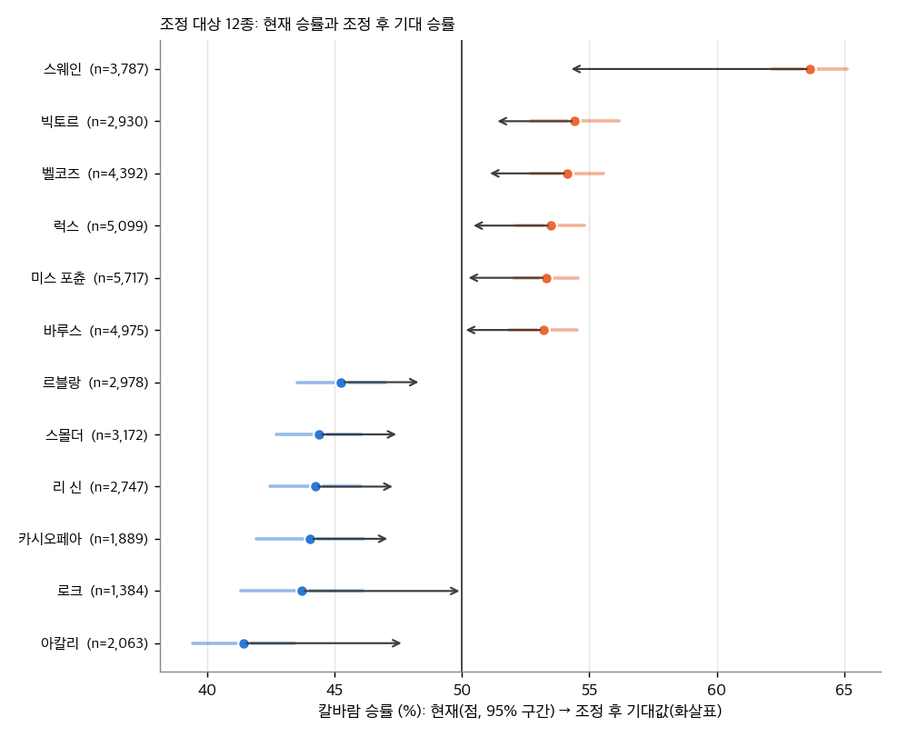
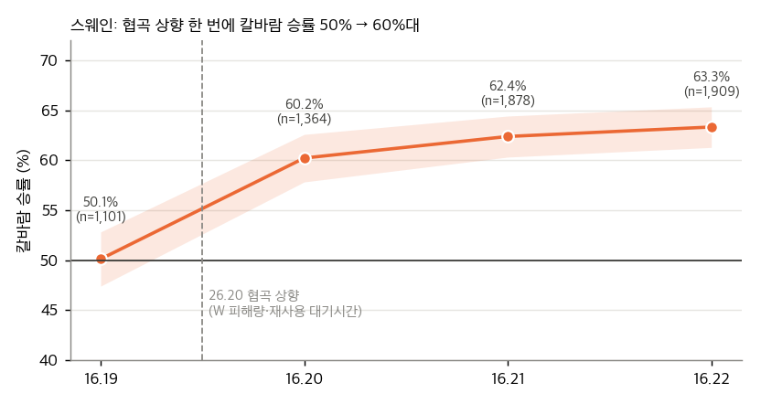
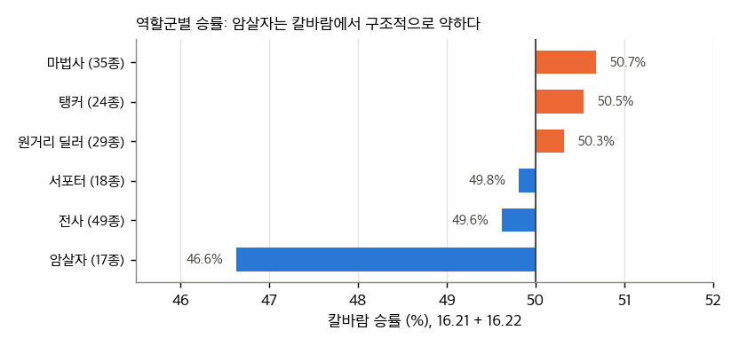

# 칼바람 조정 패치노트 (Poro Lab 제안)

> 기준 데이터: KR 일반 칼바람(큐 450), 16.19 ~ 16.22 패치 약 7만 경기
> 진단: 최근 두 패치(16.21 + 16.22) 약 4만 경기
> 재현: `python src/make_patch_notes.py` → `reports/patch_notes_candidates.csv`, `reports/figures/`
> 분석 근거: [`notebooks/02_patch_effects.ipynb`](../notebooks/02_patch_effects.ipynb)

이 문서는 Riot의 공식 패치노트가 아닙니다. 공개 API 데이터로 만든 **개인 분석 제안**입니다.

---

## 요약

협곡 밸런스 변경은 칼바람 승률을 평균 1%p 안팎만 움직이지만, 가끔 크게 증폭됩니다.
대표 사례가 **스웨인**입니다. 26.20 협곡 상향 한 번으로 칼바람 승률이 50%에서 63%까지 올랐습니다.
이 패치노트는 협곡과 따로 조정할 수 있는 **칼바람 전용 보정치**(입히는 피해량, 받는 피해량)로 12명을 조정합니다.

| | 챔피언 | 현재 승률 (95% 구간) | 조정 | 기대 승률 |
|---|---|---|---|---|
| ⬇ | **스웨인** | **63.6%** (62.2~65.1) | 입히는 피해 -5%p, 받는 피해 +10%p | 54.2% |
| ⬇ | 빅토르 | 54.4% (52.7~56.2) | 입히는 피해 -5%p | 51.3% |
| ⬇ | 벨코즈 | 54.1% (52.7~55.6) | 입히는 피해 -5%p | 51.0% |
| ⬇ | 럭스 | 53.5% (52.1~54.8) | 받는 피해 +5%p | 50.3% |
| ⬇ | 미스 포츈 | 53.3% (52.0~54.6) | 입히는 피해 -5%p | 50.1% |
| ⬇ | 바루스 | 53.2% (51.8~54.5) | 입히는 피해 -5%p | 50.0% |
| ⬆ | 아칼리 | 41.4% (39.4~43.4) | 입히는 피해 +5%p, 받는 피해 -5%p | 47.8% |
| ⬆ | 로크 | 43.7% (41.3~46.1) | 입히는 피해 +5%p, 받는 피해 -5%p | 50.0% |
| ⬆ | 카시오페아 | 44.0% (42.0~46.2) | 입히는 피해 +5%p | 47.2% |
| ⬆ | 리 신 | 44.2% (42.5~46.0) | 입히는 피해 +5%p | 47.4% |
| ⬆ | 스몰더 | 44.4% (42.7~46.1) | 입히는 피해 +5%p | 47.6% |
| ⬆ | 르블랑 | 45.3% (43.6~47.0) | 입히는 피해 +5%p | 48.4% |

---

## 어떻게 정했나

**1. 대상 고르기**
- 승률은 경험적 베이즈로 50% 쪽으로 축소한 값을 쓴다. 판수가 적어서 생기는 극단값을 걸러내기 위해서다.
- 아래 두 조건을 모두 만족하는 챔피언 중에서 `|승률 - 50| × 픽률`이 큰 순서로 골랐다. 많이 나오는 챔피언일수록 많은 판에 영향을 주기 때문이다.
  - 4개 패치(16.19~16.22) 내내 한쪽으로 치우쳐 있다.
  - 95% 구간이 50%를 포함하지 않는다.
- 스웨인은 16.19에는 50%라 "4개 패치 내내" 조건에 걸리지 않는다. 하지만 원인 패치가 특정되고 현재 가장 강하므로 1순위로 넣었다.

**2. 어떤 보정치를 바꿀지: 진단**
챔피언마다 같은 역할군(Data Dragon 태그) 평균과 비교해서 정했다.
- 분당 가하는 피해가 높으면 → 입히는 피해를 조정한다.
- 분당 받는 피해와 사망이 문제면 → 받는 피해를 조정한다.
- 짧은 게임(18분 미만)과 긴 게임의 승률 차이도 참고했다.

**3. 얼마나 바꿀지: 환산값**
26.20의 실제 칼바람 보정 변경 두 건으로 효과를 측정했다. 벨베스(하향)는 -7.8%p, 로크(상향)는 +5.4%p였다.
여기서 나온 환산값은 **보정치 1%p당 승률 약 0.63%p** (95% 구간 0.12~1.14)이다.
- 조정 폭은 5%p 단위로 잡고, 목표치를 넘지 않게 내림했다.
- 한 번에 10%p를 넘기지 않는다. 스웨인만 예외로 15%p다.
- 환산값의 구간이 넓으므로 **조금씩 조정하고 다음 패치에 다시 재는** 방식을 택했다.

---

## 하향

### 스웨인: 입히는 피해 100% → 95%, 받는 피해 100% → 110%

| 16.19 | 16.20 | 16.21 | 16.22 | 짧은 게임 | 긴 게임 |
|---|---|---|---|---|---|
| 50.1% | 60.2% | 62.4% | 63.3% | 71.0% | 57.1% |

- **원인:** 26.20 협곡 상향(W 제국의 눈 피해량 상향, 재사용 대기시간 22→20초)이다.
  - 이중차분 추정치는 **+12.1%p** (95% 구간 8.1~16.0)이다.
  - 84개 비교 중 다중비교 보정 후에도 유일하게 유의하다.
- **착시가 아닌지 확인했다**
  - 1,700여 명이 플레이했고 한 명이 최대 5경기라, 특정 플레이어의 영향이 아니다.
  - 플레이어당 1경기만 남겨도 승률이 같다(65.2%).
  - 세부 버전마다 62~65%이다. 주 단위로 봐도 26.20 출시 첫 주(57%, 130경기)를 빼면 모두 62~68%다.
  - 외부 통계(MetaSrc 26.22, 2.4만 경기)도 63.2%다.
- **진단:** 받는 피해가 같은 마법사의 **2.2배**인데 사망은 14% 적다. 앞에서 피해를 받아내면서 회복으로 버티는 구조라 칼바람 한타에서 특히 강하다.
  짧은 게임 승률이 71%로, 초반 한타부터 압도한다.
- **조정:** 받는 피해를 주로 올리고 입히는 피해를 조금 낮춘다(합계 15%p).
  - 기대 승률은 54.2% (구간 46.5~61.8)이다. 한 번에 50%로 맞추려면 20%p 이상이 필요하지만, 환산값의 불확실성 때문에 나눠서 조정한다.
  - 다음 패치에서 다시 재고 추가 조정을 판단한다.

### 빅토르: 입히는 피해 -5%p
- 4개 패치 승률은 54.5% → 51.1% → 52.7% → 55.4%이다.
- 26.21 협곡 하향으로 잠시 내려갔다가, 26.22 협곡 상향 뒤 다시 55%가 됐다.
- 분당 가하는 피해가 마법사 평균보다 10% 높다.

### 벨코즈: 입히는 피해 -5%p
- 4개 패치 내내 53~55%이다.
- 분당 가하는 피해가 마법사 평균보다 10% 높고, 짧은 게임 승률이 58%다. 사거리 긴 견제로 초반 한타 전에 체력 우위를 만든다.

### 럭스: 받는 피해 +5%p
- 4개 패치 내내 52~54%이고, 픽률이 경기의 12.5%로 높다.
- 가하는 피해는 오히려 평균보다 9% 낮다. 대신 받는 피해 -26%, 사망 -22%로 안전하게 싸운다. 그래서 피해가 아니라 생존 쪽을 조정한다.

### 미스 포츈: 입히는 피해 -5%p
- 53% 안팎으로 차이는 작지만, **픽률이 경기의 14%로 가장 높은 축**이라 체감 영향이 크다.
- 분당 가하는 피해가 원딜 평균보다 5% 높다.

### 바루스: 입히는 피해 -5%p
- 16.19~16.20에는 50% 안팎이었다. 26.21 협곡 조정(Q·W 구조 변경, 10/22 추가 상향) 이후 53%로 올라왔다.
- 짧은 게임 승률이 59%로, 초반 견제 압박이 강하다.

---

## 상향

### 아칼리: 입히는 피해 +5%p, 받는 피해 -5%p
- 4개 패치 내내 41~44%로, 전체 챔피언 중 가장 약하다.
- 받는 피해가 암살자 평균보다 25% 많고, 짧은 게임과 긴 게임 모두 40% 안팎이다. 진입 비용이 큰 구조라 피해와 생존을 함께 올린다.
- 기대 승률은 47.8% (구간 42.7~52.9)이다.

### 로크: 입히는 피해 +5%p, 받는 피해 -5%p
- 26.20에서 이미 칼바람 보정을 받았다(입히는 피해 105→115%).
  - 이중차분 추정치 +5.4%p로 효과는 있었지만, 여전히 44%다.
  - 그 뒤 26.21·26.22 협곡에서 연속으로 하향됐다.
- 받는 피해 +14%, 사망 +6%로 생존이 문제다. 이번에는 받는 피해 쪽을 함께 조정한다.

### 카시오페아: 입히는 피해 +5%p
- 4개 패치 내내 44~45%이다.
- 분당 가하는 피해가 마법사 평균보다 13% 낮고, 받는 피해는 27% 많다.

### 리 신: 입히는 피해 +5%p
- 짧은 게임 43.9%, 긴 게임 43.5%로 고르게 약하다.
- 받는 피해는 평균보다 적다. 들어가서 버티는 게 아니라, 들어간 뒤 마무리 피해가 부족한 것으로 보고 피해를 올린다.

### 스몰더: 입히는 피해 +5%p
- 26.20·26.22 협곡에서 두 번 상향됐는데도 44~46%이다. 이중차분 추정치도 +1~2%p로 작다.
- 짧은 게임 40.5%, 긴 게임 47.0%로 성장 전 구간이 특히 약하다. 분당 가하는 피해는 원딜 평균보다 7% 낮다.

### 르블랑: 입히는 피해 +5%p
- 4개 패치 내내 45~46%이고, 픽률은 경기의 7%다.
- 피해·생존 지표는 오히려 평균 이상이라 **약한 원인이 지표로 뚜렷하지 않다.** 최소 폭만 조정하고 관찰한다.

---

## 관찰 목록 (이번에는 조정하지 않음)

| 챔피언 | 현재 승률 | 이유 |
|---|---|---|
| 칼리스타 | 56.1% | Riot이 26.23에서 이미 칼바람 보정을 하향했다(입히는 피해 110→105%, 받는 피해 90→100%). 16.23 데이터로 효과를 확인하고, 환산값 검증에도 쓴다 |
| 직스 | 53.2% | 벨코즈·바루스와 같은 원거리 견제형이다. 이번 하향들의 파급 효과를 본 뒤 결정한다 |
| 케넨 | 45.4% | 26.20 협곡 상향(E 공격 속도)이 칼바람에서는 효과가 없었다 |

칼리스타는 우리 기준에서 4개 패치 내내 강세였는데, Riot이 실제로 칼바람 보정을 하향했다. 이 방법이 실제 조정 대상을 찾아낸다는 근거다.

---

## 검토 과제: 암살자 역할군

- 암살자 17종의 평균 승률은 **46.6%**로, 다른 역할군(49.6~50.7%)보다 확연히 낮다.
- 약세 상위권에 아칼리, 로크, 렝가, 나피리, 카직스, 르블랑, 제드가 몰려 있다.
- 칼바람은 한 라인에서 계속 한타를 하는 구조라 "고립된 대상 암살"이 잘 성립하지 않는다.
- 개별 보정을 계속하기보다, 역할군 단위 조정(예: 암살자 전체 받는 피해 -5%p)을 따로 검토할 만하다.

---

## 다음 패치에서 확인할 것
1. **칼리스타 (26.23 실제 보정 하향):** 16.23 데이터로 효과를 재서 환산값(1%p당 0.63%p)을 검증·보정한다.
2. **스웨인:** 하향이 적용됐다고 가정하면 54% 근처가 목표다. 실제로는 적용되지 않으므로, 대신 16.23에서 스웨인이 계속 63%대인지 추적한다.
3. **과거 보정 사례 추가:** 26.10 빅토르, 26.4 자헨 패치를 수집해서 환산값 사례를 2개에서 4~5개로 늘린다.

## 한계
- 환산값은 사례 2개에서 나왔고 구간이 넓다(1%p당 0.12~1.14%p). 기대 승률은 방향과 대략적인 크기로만 읽어야 한다.
- 각 챔피언의 현재 칼바람 보정치 절대값은 API로 받을 수 없다. 그래서 조정은 "현재 값에서 ±%p"로 표기했다.
- "입히는 피해 +1%p"와 "받는 피해 -1%p"를 같은 크기로 가정했다.
- 스노볼 표본이라 칼바람을 자주 하는 플레이어가 과대표집됐다(플레이어당 3경기로 제한해 완화).
- 칼바람은 리롤·교환이 있어서 챔피언 배정이 완전히 무작위가 아니다. 강한 챔피언을 잘하는 사람이 가져갈 수 있다.
- 공개되는 수치는 모두 챔피언 단위 집계이며, 개별 플레이어 정보는 포함하지 않는다.

---

*Poro Lab isn't endorsed by Riot Games and doesn't reflect the views or opinions of Riot Games or anyone officially involved in producing or managing Riot Games properties.*
